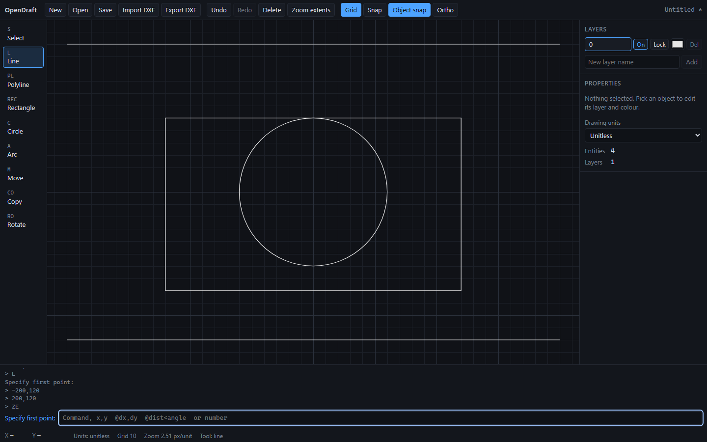

# OpenDraft

A lightweight, browser-based 2D drafting application. It runs locally, needs no account, and reads and writes a practical subset of DXF.

> OpenDraft is **not** a replacement for AutoCAD. It supports a deliberately small set of entities and commands, described below. Anything outside that set is reported, not silently dropped.



## Status

Milestone 1 (drafting vertical slice) is implemented. See [docs/ROADMAP.md](docs/ROADMAP.md) for what comes next.

| Area | Status |
|---|---|
| Viewport, grid, pan, zoom | Done |
| Line, polyline, rectangle, circle, arc | Done |
| Select, window and crossing selection | Done |
| Move, copy, rotate, delete | Done |
| Undo and redo | Done |
| Object snap (endpoint, midpoint, centre, intersection), grid snap, ortho | Done |
| Layers (create, rename, delete, visible, locked, colour) | Done |
| Native save and open | Done |
| DXF import and export (subset below) | Done |
| Trim, extend, offset, fillet, scale, mirror | Not yet |
| Text, dimensions, hatch, blocks, splines in DXF | Not yet (reported on import) |
| Desktop app, 3D | Not yet |

## Requirements

- Node.js 22.12 or newer (Vitest 5 does not support Node 20). Developed and tested with Node 24.15.
- npm 10 or newer.
- A current Chromium-based browser. The automated browser tests run only in Chromium. Firefox and Safari have not been tested.

## Getting started

```bash
npm install
npm run dev          # http://localhost:5173
```

Build a static bundle:

```bash
npm run build        # type check + production build in dist/
npm run preview      # serve dist/ locally
```

## Using OpenDraft

The bottom command line accepts tool names, aliases, coordinates and numbers. It follows the active step's prompt.

| Input | Meaning |
|---|---|
| `L`, `C`, `A`, `PL`, `REC` | Line, circle, arc, polyline, rectangle |
| `M`, `CO`, `RO` | Move, copy, rotate (act on the selection) |
| `E` | Delete the selection |
| `U`, `REDO` | Undo, redo |
| `ZE` | Zoom to extents |
| `x,y` | Absolute point |
| `@dx,dy` | Point relative to the last point |
| `@distance<angle` | Polar offset from the last point, angle in degrees |
| A number | A distance or angle, when the active step asks for one (for example a circle radius) |
| Enter | Finish the current step or tool |

### Shortcuts

| Key | Action |
|---|---|
| `L`, `P`, `R`, `C`, `A`, `M`, `O`, `T` | Line, polyline, rectangle, circle, arc, move, copy, rotate |
| `Esc` | Cancel the step in progress; in Select mode, clear the selection |
| `Enter` | Confirm |
| `Del` / `Backspace` | Delete the selection |
| `Ctrl+Z`, `Ctrl+Y` / `Ctrl+Shift+Z` | Undo, redo |
| `Ctrl+A` | Select all |
| `Ctrl+N`, `Ctrl+O`, `Ctrl+S`, `Ctrl+I` | New, open, save, import DXF |
| `F3`, `F7`, `F8`, `F9` | Object snap, grid display, ortho, grid snap |
| Middle mouse drag, or Space + drag | Pan |
| Mouse wheel | Zoom at the pointer |
| Drag left to right | Window selection (fully enclosed) |
| Drag right to left | Crossing selection (touching) |
| Shift + click | Add to or remove from the selection |

### Layers and properties

- The layer panel sets the active layer, which new entities use. Double-click a layer name to rename it (layer 0 cannot be renamed or deleted).
- Deleting a layer moves its entities to layer 0 in one undo step.
- Locked and hidden layers cannot be selected, snapped to or edited.
- The properties panel changes the layer and colour of the selection. "By layer" makes an entity follow its layer colour.

## File formats

### Native drawing (`.opendraft.json`)

JSON, with `format: "opendraft-drawing"` and `version: 1`. It stores units, layers, entities and the id counter. Files are validated completely before anything loads. A file that fails validation is rejected with a message, and the current drawing is kept.

### DXF

**Export** writes an AutoCAD DXF with `$INSUNITS`, a LAYER table, and these entities: LINE, CIRCLE, ARC, LWPOLYLINE (open or closed).

**Import** reads the same entity types, plus `$INSUNITS` and the LAYER table. Anything else is skipped and listed in an import report. Polyline bulge arcs are approximated with straight segments within 5 degrees, and the report says how many were approximated.

Colour notes:

- Entity colours are written as true colour and round-trip exactly.
- Layer colours must be written in the AutoCAD palette. The seven primary colours are exact. Other layer colours are approximated to the nearest one, and the export report says which layers changed.

Round-trip behaviour is covered by tests that use a hand-written DXF fixture (`tests/fixtures/mixed-sample.dxf`), so the claims above are checked, not assumed.

## Geometry, units and tolerances

- Coordinates are plain numbers in the drawing's units. The units setting is metadata for display and DXF. OpenDraft does not convert units.
- Equality tests use a relative tolerance of `1e-9` scaled to the magnitude of the coordinates. Tests cover values from `1e-3` to `1e12`.
- Pick and snap radii are 8 screen pixels, converted to drawing units at the current zoom.
- Tangent circles produce one intersection point. Parallel and collinear segments produce none. Nearly parallel segments (sine of the angle below `1e-9`) are treated as parallel.
- Arcs run counter-clockwise from the start angle to the end angle. A zero sweep is invalid.

## Limitations

- **Supported entities:** line, polyline (open and closed, with flattened bulge arcs on import), rectangle (stored as a closed polyline), circle, arc.
- **Transforms:** move, copy and rotate only. Scale and mirror are not implemented.
- **Editing:** there is no trim, extend, offset, fillet, chamfer or text.
- **DXF:** the reader is not a general DXF parser. Text, dimensions, hatches, blocks, inserts, splines, ellipses and images are skipped and reported.
- **Colours:** layer colours outside the seven primary AutoCAD colours are approximated on export.
- **Saving:** Save downloads a file. OpenDraft does not keep a file handle, so Save always writes a new download.
- **Performance:** interaction is measured up to 10,000 entities (see [docs/BENCHMARKS.md](docs/BENCHMARKS.md)). Larger drawings have not been tested. Picking and snapping scan every entity.
- **Browsers and devices:** automated browser tests run in Chromium only. Touch input is not supported.
- **Compatibility:** OpenDraft does not claim compatibility with AutoCAD files beyond the subset described above.

## Testing

```bash
npm test             # unit and integration tests (Vitest)
npm run typecheck    # TypeScript, strict mode
npm run lint         # oxlint
npm run check        # all of the above
npm run e2e          # browser workflows (Playwright)
npm run bench        # timing baselines, writes docs/BENCHMARKS.md
```

The first time you run `npm run e2e`, install the browser:

```bash
npx playwright install chromium
```

## Project layout

```
src/core/         geometry, entities, document, history, selection, snapping, tools (no React, no DOM)
src/io/           native format and DXF import and export
src/state/        EditorSession: the bridge between core and UI
src/viewport/     camera transforms, Canvas 2D renderer, canvas component
src/components/   React panels, toolbar, command line, status bar, dialogs
tests/            unit, integration, fixtures, e2e, bench
docs/             research, architecture, roadmap, benchmarks, decision records
```

See [docs/ARCHITECTURE.md](docs/ARCHITECTURE.md) for module rules.

## Contributing

See [CONTRIBUTING.md](CONTRIBUTING.md) and the [code of conduct](CODE_OF_CONDUCT.md).

## Licence

MIT. See [LICENSE](LICENSE). Third-party licences are listed in [THIRD_PARTY_NOTICES.md](THIRD_PARTY_NOTICES.md).
